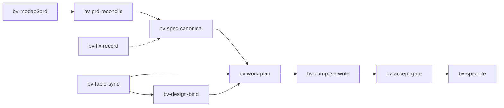

# Boostvision AI 重构流水线 — Skill 使用说明

本文档说明本仓库全部 **`bv-*`** Skill 的职责、用法与产物，供产品、开发、测试同事查阅。  
本仓库 **全部 `bv-*` Skill 均在本仓 `.cursor/skills/`**（含墨刀导出，无单独的 `modao2prd`）：

```text
bv-modao2prd · bv-prd-reconcile · bv-spec-canonical · bv-table-sync · bv-design-bind
bv-work-plan · bv-compose-write · bv-accept-gate · bv-fix-record · bv-debug-console · bv-spec-lite
bv-feishu-task · bv-index · bv-refactor-pipeline · bv-existing-logic
```

zhongnan 示范克隆与 workspace：见 [demo-zhongnan.md](demo-zhongnan.md)。本机 `@bv-*` 识别：运行 `./scripts/link-bv-skills.sh`。

Agent 对话中通过 `@bv-<name>` 引用；命令行脚本统一为 `run_bv_modao2prd.sh` 等 `bv-` 命名。

详细执行规范见：`.cursor/skills/bv-<name>/SKILL.md`  
总调度规则见：仓库根目录 [`AGENTS.md`](../AGENTS.md)

---

## 一、这套 Skill 解决什么问题

老 Android 项目重构目标：

1. 把历代墨刀需求、飞书配置/埋点/多语言、蓝湖 UI **收成 AI 能稳定读取的规格**
2. 按模块 **XML → Compose** 重写，代码结构便于未来 Agent 维护
3. 重构完成后收敛为 **少量 MD + 代码**，未来版本由产品 Agent 直接改文档和代码

---

## 二、五条输入源 vs 九个 Skill

| 输入源 | 管什么 | 不管什么 | 相关 Skill |
|--------|--------|----------|------------|
| **墨刀** | 页面流程、状态分支、交互批注 | 像素级 UI、色值间距 | bv-modao2prd、bv-prd-reconcile、bv-spec-canonical |
| **Git ChangeLog** | 无墨刀版本的更新说明 | UI 流程 | bv-prd-reconcile |
| **蓝湖** | 布局、组件、切图、标注 | 业务状态机 | bv-design-bind |
| **飞书配置表** | 远程开关、SKU、Paywall JSON | UI 长文案 | bv-table-sync |
| **飞书埋点表** | 事件名、参数、触发时机 | 页面结构 | bv-table-sync |
| **飞书多语言表** | 文案 key 与中英文 | 哪些页面用哪个 key | bv-table-sync |

**分工原则**：墨刀定「做什么、什么时候做」；蓝湖定「长什么样」；飞书表定「配什么、打什么点、说什么话」。

---

## 三、仓库目录与 Skill 对应关系

```text
AI/
  modao-output/          ← bv-modao2prd（按版本 Archive，可多目录）
  modao-output/_reconciled/ ← bv-prd-reconcile（去重 + ChangeLog 补缺后的单一 Archive）
  spec/modules/          ← bv-spec-canonical（当前态模块 spec，写代码只读这里）
  registry/              ← bv-table-sync（配置 / 埋点 / 多语言 JSON）
  design/bindings.md     ← bv-design-bind（蓝湖 ↔ 模块 ↔ 代码路径）
  plan/                  ← bv-work-plan（Compose 工步计划）
  gate/                  ← bv-accept-gate（验收清单）
  learn/                 ← bv-fix-record（bug 与踩坑记录）
  .cursor/skills/bv-debug-console/  ← INTERNAL 调试台规范（实现落在 Android feature/debug/）
  docs/                  ← bv-spec-lite（重构完成后的主文档）
```

Android 工程内：`app/src/main/java/.../feature/<模块包名>/` 必须与 `spec/modules/<模块名>.md` **同名**（**包路径**，非 Gradle module；连字符转驼峰如 `device-search` → `devicesearch`）。

---

## 四、流水线总览



**主路径（必须按序）**：

```text
bv-modao2prd → bv-prd-reconcile → bv-spec-canonical → bv-table-sync → bv-design-bind
  → bv-work-plan → bv-compose-write（逐步）→ bv-accept-gate
```

**横切**：重构过程中修 bug 用 **bv-fix-record**；INTERNAL 调试台 / 飞书测试配置 Sync 用 **bv-debug-console**；全 App Compose 完成后用 **bv-spec-lite** 做文档瘦身。

---

## 五、各 Skill 说明

### 1. bv-modao2prd — 墨刀 → Archive PRD

| 项目 | 说明 |
|------|------|
| **职责** | 把墨刀 project 分享链接导出为按**版本**分组的 PRD Markdown（含截图与批注） |
| **阶段** | 流水线第 1 步 |
| **输入** | 墨刀分享链接 `https://modao.cc/proto/<token>/sharing?view_mode=read_only` |
| **输出** | `modao-output/<项目名>__<token>/` 下的 `urls_codex`、`.exports/`、`<版本名>.md` |
| **谁用** | 产品 / Agent；全版本重构前先跑 Archive |
| **注意** | 产物是**历史 Archive**，不直接用于写 Compose；写代码读 `spec/modules/` |

**三步流程**：

1. 生成 `urls_codex`（版本树 + 画布 URL）
2. 逐画布导出截图与批注
3. 合并为各版本 `.md`

**常用命令**：

```bash
# 全版本导出（Step 1+2）
bash scripts/run_bv_modao2prd.sh "https://modao.cc/proto/<token>/sharing?view_mode=read_only"

# 仅某一版本
bash scripts/run_bv_modao2prd.sh "<url>" "modao-output/<项目>__<token>" --version "v1.4.6"

# 合并 PRD（Step 3）
node scripts/build_prd.mjs \
  "modao-output/<项目>__<token>/urls_codex" \
  "modao-output/<项目>__<token>/.exports" \
  "modao-output/<项目>__<token>"
```

**对话触发**：

```text
@bv-modao2prd
墨刀：https://modao.cc/proto/.../sharing?view_mode=read_only
```

#### 墨刀 V7 → V8：产品侧必须先做版本叠加转化

历史项目常见两种墨刀工程形态：

| 形态 | 典型项目名 | 分享链接 | bv-modao2prd |
|------|-----------|----------|--------------|
| **V7（旧）** | `【已上线V7】v1.0.0-v1.1.8` | 常为 `/app/<token>#...` 或「分享1」 | ❌ 通常失败（API `RESTRICTED`） |
| **V8（新）** | `【合集V8】Miracast_GP` | `/proto/<token>/sharing?view_mode=read_only` | ✅ 标准流程可用 |

**原因**：V7 是墨刀旧版工程，各版本分散维护；即便浏览器里能看全页面，后端节点树 API 仍可能被标为受限预览，Archive 第一步 `generate_urls_codex` 会 403。

**产品操作（一次性）**：在墨刀里把 V7 **每个版本文件夹**依次 **叠加 / 一键转化成 V8**（版本挨着挨着合并进同一个 V8 合集工程），转化完成后：

1. 项目名变为类似 `【合集V8】Miracast_GP`
2. 分享 → 复制链接，格式为 `https://modao.cc/proto/<token>/sharing?view_mode=read_only`
3. 将该链接交给开发 / Agent 跑 `@bv-modao2prd`

**不要**再使用 V7 工程的 `/app/` 工作台链接或旧「分享1」链接跑 Archive；V8 转化后的 `/proto/.../sharing` 才是流水线认可的输入。

**耗时统计**（用于评估 AI 重构方法）：每次运行后在 `modao-output/<项目>__<token>/` 生成 `run-stats.json`（历次追加）与 `run-stats.latest.txt`（最近一次摘要，含总分钟数、各阶段耗时、画布数、平均每画布耗时）。

```bash
node scripts/bv_modao_run_stats.mjs summary modao-output/<项目>__<token>/
```

---

### 2. bv-prd-reconcile — 多源 Archive 对齐

| 项目 | 说明 |
|------|------|
| **职责** | 合并多个 `modao-output` 目录：重复 semver **新覆盖旧**；缺失版本从 Git **ChangeLog** 补充 |
| **阶段** | 流水线第 1.5 步（modao2prd 之后、spec-canonical 之前） |
| **输入** | 多个 `--source` modao-output 子目录（从旧到新）；Git 仓库 URL 或本地路径 |
| **输出** | `modao-output/_reconciled/<project>/`（`manifest.json`、`report.md`、`versions/`） |
| **谁用** | 产品 / Agent；Miracast 等多墨刀工程项目 **必跑** |
| **注意** | 不要手动合并三个 modao-output 目录；ChangeLog 补充无截图 |

**Miracast 典型配置**（`modao-output/miracast.reconcile.json`）：

```json
{
  "project": "miracast",
  "sources": [
    "modao-output/【已上线V8】v1.0.0-v1.1.8__...",
    "modao-output/【已上线V8】v1.2.0-v1.3.2__...",
    "modao-output/【合集V8】Miracast_GP__..."
  ],
  "git_url": "https://gitlab.example.com/group/miracast.git",
  "changelog_path": "ChangeLog"
}
```

**命令**：

```bash
bash scripts/run_bv_prd_reconcile.sh modao-output/miracast.reconcile.json
```

**Gate**：阅读 `_reconciled/miracast/report.md`，确认去重（如 v1.3.0 以较新来源为准）与 ChangeLog 补充合理后再进 spec-canonical。

**对话触发**：

```text
@bv-prd-reconcile
配置：modao-output/miracast.reconcile.json
Git：https://gitlab.example.com/group/miracast.git
```

---

### 3. bv-spec-canonical — 全版本 → 模块当前态 Spec

| 项目 | 说明 |
|------|------|
| **职责** | 把 reconciled Archive 下**全部版本** PRD 合并为按**模块**组织的当前态规格 |
| **阶段** | 流水线第 2 步 |
| **输入** | `modao-output/_reconciled/<project>/versions/`；可选 `spec/as-is/` |
| **输出** | `spec/modules/<模块名>.md`、`spec/gaps.md`（差异清单） |
| **谁用** | 产品 / 开发 / Agent；**实现代码的唯一需求入口** |
| **注意** | 按模块合并，不是把 20 个版本 PRD 堆给 AI；UI 色值不写进 spec；**禁止反查 Android 代码**补 spec |

**合并规则摘要**：

- 同一模块以**最新版本**墨刀批注为准
- 配置 / 埋点 / 文案只写 **registry 引用 ID**（`CFG:` / `EVT:` / `I18N:`）
- 墨刀子画布 → spec 里的一个 **state** 或分支

**对话触发**：

```text
@bv-spec-canonical
来源：modao-output/_reconciled/miracast/
合并模块：device-search、settings、splash-loading
```

---

### 4. bv-table-sync — 飞书三表 → Registry

| 项目 | 说明 |
|------|------|
| **职责** | 同步飞书**配置表、埋点表、多语言表**到本地 JSON |
| **阶段** | 流水线第 3 步（可与 spec-canonical 并行准备） |
| **输入** | 三张飞书电子表格 URL（或 CSV 导出） |
| **输出** | `registry/config.json`、`analytics.json`、`i18n.json`、`meta.json` |
| **谁用** | 开发 / Agent；写配置解析、埋点、文案时引用 |
| **注意** | 实现时读 registry，不每次直接读飞书；引用 ID：`CFG:<key>`、`EVT:<event>`、`I18N:<key>` |

**对话触发**：

```text
@bv-table-sync
配置表：https://.../sheets/...
埋点表：https://.../sheets/...
多语言表：https://.../sheets/...
当前 App 版本：1.5.3
```

---

### 5. bv-design-bind — 蓝湖映射

| 项目 | 说明 |
|------|------|
| **职责** | 维护蓝湖设计稿与模块、Android `feature/` 路径的对应关系；通过 **Lanhu MCP** 自动列画板、拉预览与标注到 `design/cache/` |
| **阶段** | 流水线第 4 步 |
| **输入** | 蓝湖项目 stage 链接（含 `pid` + **`tid`**）、模块名 |
| **输出** | `design/bindings.md`（`DS-01` …）+ `design/cache/<模块>/DS-xx/` |
| **谁用** | UI 开发 / Agent；写 Compose 页面前必须查对应 DS-xx |
| **注意** | **UI 视觉以蓝湖为准**；不要从墨刀截图猜色值和间距；链接参数用 **`tid=`**，不是 `teamId=` |

**bindings 表示例**：

| id | 模块 | 名称 | 蓝湖链接 | 缓存 | feature 路径 | 状态 |
|----|------|------|----------|------|--------------|------|
| DS-01 | device-search | device-新增设备 | https://lanhuapp.com/...&image_id=... | cache/device-search/DS-01/ | feature/device-search/ | todo |

#### 蓝湖 MCP 安装（一次性）

与墨刀 MCP（`modao-prototype`）并列配置，供 Agent **只给项目链接** 即可读设计稿。详细故障排查见 [`.cursor/skills/bv-design-bind/references/lanhu-mcp-setup.md`](../.cursor/skills/bv-design-bind/references/lanhu-mcp-setup.md)。

**1. 在规格仓安装 `@star_work/lanhu-mcp`**

```bash
cd <规格仓根目录>
mkdir -p .cursor/tools/lanhu-mcp && cd .cursor/tools/lanhu-mcp
npm init -y
npm install @star_work/lanhu-mcp
```

**2. 安装 Playwright Chromium（lanhu-mcp 依赖 chromium-1234）**

```bash
cd .cursor/tools/lanhu-mcp
PLAYWRIGHT_BROWSERS_PATH=$HOME/Library/Caches/ms-playwright \
  node ./node_modules/playwright/cli.js install chromium
```

若报 `Executable doesn't exist at .../chromium-1234/...`，执行上述命令；勿与并行中的 `npx playwright install` 同时跑（可能锁冲突）。

**3. 写入 `~/.cursor/mcp.json`**

与现有 `modao-prototype` **并列**增加 `lanhu` server（路径改为本机规格仓绝对路径）：

```json
{
  "mcpServers": {
    "modao-prototype": { "...": "保持不动" },
    "lanhu": {
      "command": "node",
      "args": [
        "<规格仓绝对路径>/.cursor/tools/lanhu-mcp/node_modules/@star_work/lanhu-mcp/dist/index.js"
      ],
      "env": {
        "CHROME_PATH": "/Applications/Google Chrome.app/Contents/MacOS/Google Chrome",
        "PLAYWRIGHT_BROWSERS_PATH": "/Users/<你>/Library/Caches/ms-playwright"
      }
    }
  }
}
```

保存后 **重启 Cursor**。Agent 侧 MCP 命名空间为 **`user-lanhu`**（对应 `mcp.json` 里的 `lanhu`）。

**4. 首次登录蓝湖**

对话中执行一次：

```text
调用 lanhu_login 登录蓝湖
```

浏览器扫码/密码登录后，Cookie 写入 `~/.lanhu-mcp/cookie.json`（勿提交 git）。过期后重复此步。

**5. 验证**

```text
lanhu_resolve_link → https://lanhuapp.com/web/#/item/project/stage?pid=<pid>&tid=<tid>
lanhu_get_design   → 同一 URL（不传 image_id，应返回画板列表）
```

**MCP 工具速查**（namespace: `user-lanhu`）：

| 工具 | 用途 |
|------|------|
| `lanhu_login` | 登录 / 刷新 Cookie |
| `lanhu_resolve_link` | 解析 `pid`、`tid` |
| `lanhu_get_design` | 无 `image_id` → 列画板；有 `image_id` → 图层 schema |
| `lanhu_get_screenshot` | 预览图 |
| `lanhu_download_slices` | 切图 |

**链接格式**：浏览器地址栏常见 `teamId=...`，MCP 须改为 `tid=...`，例如：

```text
https://lanhuapp.com/web/#/item/project/stage?pid=537f6e5a-6555-4108-8771-28d5f167d8ae&tid=7e6fd821-1dab-4f48-8c32-80325d496c49
```

**对话触发**：

```text
@bv-design-bind
模块：device-search
蓝湖：https://lanhuapp.com/web/#/item/project/stage?pid=...&tid=...
```

Agent 将：列画板 → 映射 DS-xx → 缓存到 `design/cache/` → 更新 `design/bindings.md`。

---

### 6. bv-work-plan — 模块 Spec → 工步计划

| 项目 | 说明 |
|------|------|
| **职责** | 把一个模块的 spec 拆成**有序、可编译、可验收**的 Compose 实现工步 |
| **阶段** | 流水线第 5 步 |
| **输入** | `spec/modules/<模块>.md` + 相关 registry / bindings |
| **输出** | `plan/<模块名>-compose.md` |
| **谁用** | 开发 / Agent；驱动逐步实现，避免一次改整个 App |
| **注意** | 每步须带引用 ID 和验收编号 `AG-xxx`；一步只做一块 |

**典型工步顺序**：UDF 骨架 → 配置 → 无状态 UI → ViewModel → Navigation → **屏幕适配** → 埋点 → 联调

**对话触发**：

```text
@bv-work-plan
模块：device-search
```

---

### 7. bv-compose-write — 工步 → Compose 代码

| 项目 | 说明 |
|------|------|
| **职责** | 按 `plan/` 中的**单个工步**编写 Jetpack Compose 代码 |
| **阶段** | 流水线第 6 步 |
| **输入** | `plan/<模块>-compose.md` + 工步编号 + Android 工程路径 |
| **输出** | `app/.../feature/<模块包名>/` 下 Screen、ViewModel、UiState 等；Android 工程 `docs/` 架构说明 |
| **谁用** | 开发 / Agent |
| **架构** | **MVVM + 单向数据流（UDF）**；StateFlow 向下、UiEvent 向上 |
| **适配** | WindowSizeClass + Material3 Adaptive（手机/平板/折叠屏） |
| **注意** | 只读 `spec/modules/`；Composable 无业务逻辑；**公共工具放 `compose/`/`utils/` 全局一份**；**Theme/Color/Type 集中在 `compose/theme/`**；**内存/App Quality 见 `references/app-quality-memory.md`（[Google 博客](https://android-developers.googleblog.com/2026/08/app-quality-memory-optimization-secure-onboarding.html)，须定期重读）**；详见 `references/architecture.md` |
| **自动化** | 默认连续执行：实现 → 编译 → **`testNormalGpDebugUnitTest`** → gate → commit；详见 `references/automated-testing.md` |
| **commit** | **每工步 gate 通过后 commit 一次**；message：`<模块>: compose 工步 N — <标题>`；默认不 push；**暂存须 `git add feature/<模块包名>/` 整目录**，纳入新建 `.kt`，commit 前 `git status` 复核无遗漏 untracked |

**UDF 数据流**：

```text
User → UiEvent ↑ ViewModel.onEvent() ↓ StateFlow<UiState> → Screen → Composable
```

**目录约定**（app 单模块，参考 [MVVM+UDF](https://juejin.cn/post/7582857981894148137)）：

```text
app/src/main/java/.../feature/<模块包名>/
  entity/                 # 领域模型（列表项、枚举）
  model/                  # UiState、UiEvent、UiEffect
  ui/                     # Screen、Route、无状态 Composable
  data/                   # Repository
  <Module>ViewModel.kt
compose/                  # 全局主题与通用组件
  theme/                  # Color.kt / Type.kt / Theme.kt（AppTheme）
docs/compose-mvvm-udf.md  # Android 工程内架构说明
```

**对话触发**：

```text
@bv-compose-write
执行 plan/device-search-compose.md 工步 3
Android 工程：/path/to/zhongnan.android
架构：MVVM + UDF，需支持折叠屏/平板适配
```

---

### 8. bv-accept-gate — 验收门禁

| 项目 | 说明 |
|------|------|
| **职责** | 为模块/工步生成可执行的验收清单 |
| **阶段** | 流水线第 7 步；与 work-plan 工步一一对应 |
| **输入** | spec + plan + 可选 learn/incidents |
| **输出** | `gate/<模块名>.md`（编号 `AG-<模块>-<序号>`） |
| **谁用** | 测试 / 开发 / Agent |
| **注意** | **未过 gate 不开下一工步**；验收须写清「操作 → 预期」 |
| **与 compose-write** | 工步完成后由 compose-write **自动自检**当前 AG，通过后再 commit；真机项可标「待手测」留到联调工步 |

**对话触发**：

```text
@bv-accept-gate
模块：device-search
```

---

### 9. bv-fix-record — Bug / 经验沉淀

| 项目 | 说明 |
|------|------|
| **职责** | 把 bug 修复与踩坑经验结构化写入仓库，供后续 Agent 读取 |
| **阶段** | **横切**（重构全程随时可用） |
| **输入** | 现象、根因、修复、关联模块 |
| **输出** | `learn/incidents/INC-xxx.md`、`learn/gotchas.md` |
| **谁用** | 开发 / 测试 |
| **注意** | 若改变产品行为，须**回写** `spec/modules/`；不是「AI 记忆对话」 |

**对话触发**：

```text
@bv-fix-record
记录：镜像开始 5s 超时断开，根因是 timeout Job 未 cancel
模块：mirror-flow
```

---

### 10. bv-debug-console — INTERNAL 调试台

| 项目 | 说明 |
|------|------|
| **职责** | INTERNAL 全屏 Debug Console（埋点/配置/广告/订阅/日志）；飞书测试 Firebase 配置表 **运行时 Sync**，与 Jenkins `-fu/-fkc/-fvc` 对齐 |
| **阶段** | **横切**（Android internal 测试包） |
| **输入** | Android 工程路径；Jenkins 表 URL/列参数；飞书凭证（不进 Git） |
| **输出** | `app/.../feature/debug/`、`AppLog.kt`、ConfigManager 运行时覆盖、`app/build.gradle` BuildConfig 字段 |
| **谁用** | 开发 / 测试 |
| **注意** | 仅 `BuildConfig.INTERNAL`；禁止硬编码 B/F 列与 secret；Config 列表保持 **表格行序**（`LinkedHashMap`） |

**对话触发**：

```text
@bv-debug-console 接入 Debug Console 与 Jenkins 飞书 Sync
@bv-debug-console Config 顺序与飞书表不一致
```

详规：`.cursor/skills/bv-debug-console/references/debug-console.md`

---

### 11. bv-spec-lite — 文档瘦身（收尾）

| 项目 | 说明 |
|------|------|
| **职责** | Compose 全量重构完成后，将 spec/registry 收敛为少量长期 MD |
| **阶段** | 流水线**最后一步** |
| **输入** | `spec/`、`registry/`、`learn/` |
| **输出** | `docs/product.md`、`architecture.md`、`modules/*.md`、`config.md`、`analytics.md`、`changelog.md` |
| **谁用** | 产品 / Agent |
| **注意** | 之后日常开发只维护 `docs/` + 代码；墨刀/飞书表降为 Archive，非日常输入 |

**对话触发**：

```text
@bv-spec-lite
Miracast GP Compose 重构已完成，开始文档收敛
```

---

## 六、角色速查：我该用哪个 Skill？

| 角色 | 常见任务 | 使用的 Skill |
|------|----------|--------------|
| **产品** | 导出/核对墨刀需求 | bv-modao2prd → bv-prd-reconcile → bv-spec-canonical |
| **产品** | 维护飞书配置/埋点/文案表 | bv-table-sync |
| **UI** | 提供蓝湖链接、核对视觉 | bv-design-bind |
| **开发** | 拆任务、写 Compose | bv-work-plan → bv-compose-write |
| **开发** | 修 bug 并留档 | bv-fix-record |
| **开发 / 测试** | INTERNAL 调试台、飞书测试配置 Sync | bv-debug-console |
| **测试** | 写/跑验收 | bv-accept-gate |
| **全员** | 重构收尾、未来 Agent 维护 | bv-spec-lite |

---

## 七、典型场景 walkthrough

### 场景 A：刚开始全版本重构

```text
1. @bv-modao2prd          全版本导出 modao-output/（可多目录）
2. @bv-prd-reconcile      去重 + ChangeLog 补缺 → _reconciled/
3. @bv-spec-canonical     合并 spec/modules/
4. @bv-table-sync         同步 registry/
5. @bv-design-bind        补全 design/bindings.md
```

### 场景 B：实现某一个模块（如 device-search）

```text
1. @bv-work-plan          → plan/device-search-compose.md
2. @bv-accept-gate        → gate/device-search.md
3. @bv-compose-write      逐步执行各工步
4. 测试按 gate 验收，通过后 bindings 标 done
```

### 场景 C：重构过程中修 bug

```text
1. 修代码
2. @bv-fix-record         写 INC-xxx
3. 若需求理解变更 → 更新 spec/modules/
4. 在 gate 中增加回归项
```

### 场景 D：Compose 全 App 上线后

```text
1. @bv-spec-lite          收敛 docs/
2. 日常：只改 docs/ + feature/ 代码
```

---

## 八、全局硬规则（所有人遵守）

1. **禁止反查代码**：`bv-spec-canonical`～`bv-accept-gate` 阶段**不得**读 Android 工程补 spec/plan/gate/registry/design；缺口 → `spec/gaps.md` + 用户确认。`bv-compose-write` 可读代码做迁移，但**需求仍以 spec/registry/design 为准**
2. **写 Compose 代码**只读 `spec/modules/` + `registry/` + `design/bindings.md`
3. **不要**用 `modao-output` 里某一版 PRD 直接驱动实现
4. **UI** 以蓝湖为准；**流程/状态** 以 spec 为准；**文案/配置/埋点** 以 registry 为准
5. **一步一编译，一步一 gate**
6. **commit / push**：`bv-compose-write` 每工步 gate 通过后 **自动 commit 一次**（不 push）；暂存时 **`git add feature/<模块包名>/` 整目录**，新建 `.kt` 必须纳入；其他 skill **不自动** commit / push，除非负责人明确要求
7. `spec/modules/<名>.md` 与 Android `app/.../feature/<模块包名>/` **必须同名**（包路径）

---

## 九、Skill 文件位置

| Skill | 路径 |
|-------|------|
| bv-modao2prd | `.cursor/skills/bv-modao2prd/SKILL.md` |
| bv-prd-reconcile | `.cursor/skills/bv-prd-reconcile/SKILL.md` |
| bv-spec-canonical | `.cursor/skills/bv-spec-canonical/SKILL.md` |
| bv-table-sync | `.cursor/skills/bv-table-sync/SKILL.md` |
| bv-design-bind | `.cursor/skills/bv-design-bind/SKILL.md` |
| bv-work-plan | `.cursor/skills/bv-work-plan/SKILL.md` |
| bv-compose-write | `.cursor/skills/bv-compose-write/SKILL.md` |
| bv-accept-gate | `.cursor/skills/bv-accept-gate/SKILL.md` |
| bv-fix-record | `.cursor/skills/bv-fix-record/SKILL.md` |
| bv-debug-console | `.cursor/skills/bv-debug-console/SKILL.md` |
| bv-spec-lite | `.cursor/skills/bv-spec-lite/SKILL.md` |
| bv-feishu-task | `.cursor/skills/bv-feishu-task/SKILL.md` |
| bv-index | `.cursor/skills/bv-index/SKILL.md` |
| bv-refactor-pipeline | `.cursor/skills/bv-refactor-pipeline/SKILL.md` |
| bv-existing-logic | `.cursor/skills/bv-existing-logic/SKILL.md` |

---

## 十、FAQ

**Q：单版本验证了 bv-modao2prd，下一步做什么？**  
A：跑**全版本** Archive → `@bv-prd-reconcile` 对齐 → `@bv-spec-canonical` 合并模块 spec。

**Q：modao-output 里有三个墨刀工程目录，要手动合并吗？**  
A：不要。保持三个目录，跑 `@bv-prd-reconcile`，由程序去重并以 ChangeLog 补缺。

**Q：能不能跳过 spec，直接用 modao-output 写代码？**  
A：不建议。多版本会冲突，必须经 canonical 合并成当前态。

**Q：没有蓝湖可以先写逻辑吗？**  
A：可以。纯逻辑工步不依赖 design-bind；涉及 UI 的工步必须先有 DS-xx。需自动读蓝湖时，先按上文 **§5 蓝湖 MCP 安装** 配好 `user-lanhu`。

**Q：蓝湖链接里写的是 teamId，MCP 报错缺少 tid？**  
A：把 URL 里的 `teamId=` 改成 `tid=`（值不变），再交给 Agent。

**Q：Lanhu MCP 报 Playwright Executable doesn't exist？**  
A：在 `.cursor/tools/lanhu-mcp` 下用 `PLAYWRIGHT_BROWSERS_PATH=$HOME/Library/Caches/ms-playwright node ./node_modules/playwright/cli.js install chromium` 安装 chromium-1234。

**Q：飞书表还没同步能开工吗？**  
A：试点可以手工写几行 `registry/*.json`；全量重构建议先 `@bv-table-sync`。

**Q：bv-fix-record 和 bv-spec-lite 有什么区别？**  
A：fix-record 是重构**过程中**记 bug；spec-lite 是重构**结束后**把文档收成长期形态。

**Q：产品给的墨刀链接是 `/app/` 或【已上线V7】，Archive 跑不起来？**  
A：这是 V7 旧工程，需产品先在墨刀里把各版本 **叠加一键转化成 V8 合集**（如 `【合集V8】Miracast_GP`），再复制 `/proto/.../sharing?view_mode=read_only` 链接。转化前链接人眼能看全页，但自动化 API 会报 `RESTRICTED`。

---

*文档版本：与 bv-* Skill 系列同步。如有 Skill 变更，请同步更新本文档。*
