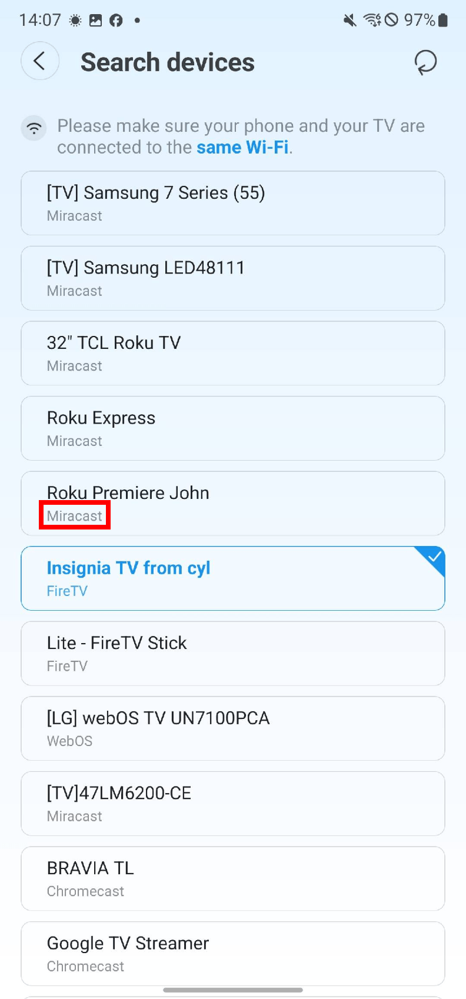
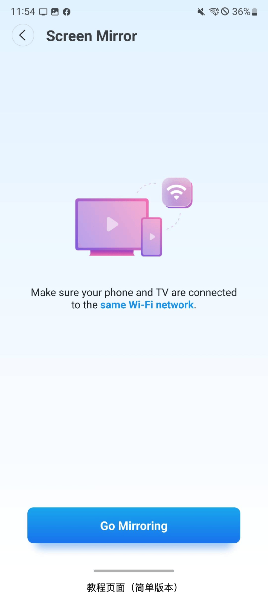
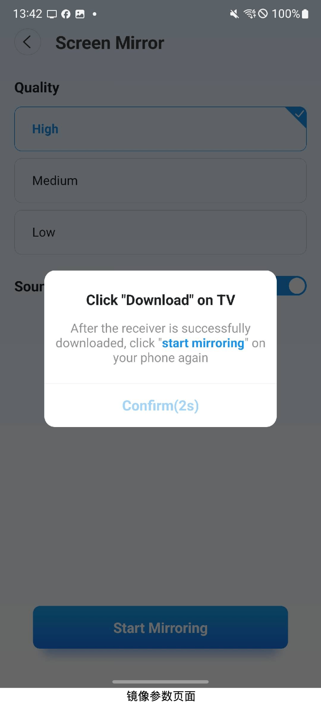
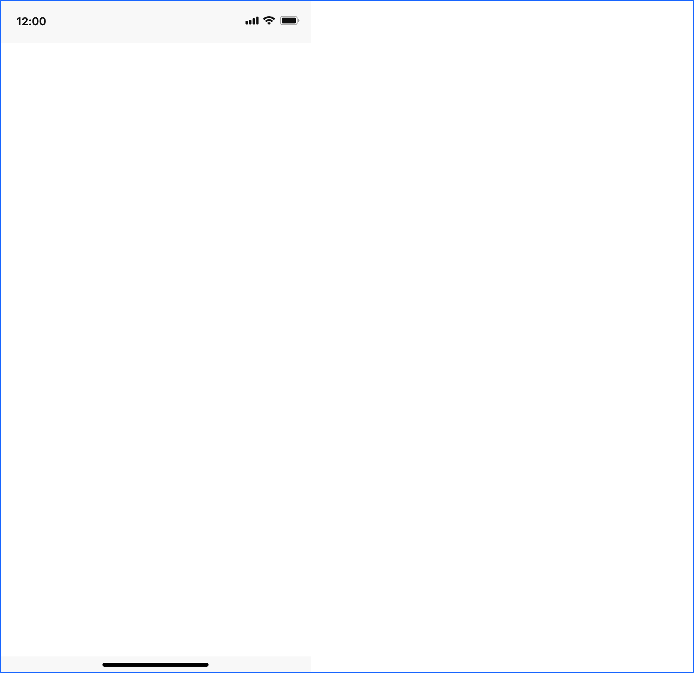
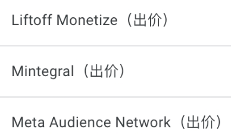

# 1 适配RokuReceiver

## 1.1 页面 1 — 1

### 页面布局

### 说明

## 1.2 页面 1 — 2

### 页面布局

### 说明

## 1.3 页面 1 — 3

### 页面布局

### 说明

批注1：【适配RokuReceiver，Channel id：800809】 「逻辑」 1. 设备搜索页面，roku下方的协议改为“Roku TV”（协议不用多语言） a. 连接设备成功后进入教程页面（简单版本） b. 连带修改：Fire 设备连接成功后，也进入教程页面（简单版本），现在是更复杂的版本 2. 当用户连接的是Roku设备，点击Start Mirroring时，若有使用资格，先判断电视上是否安装最新的RokuReceiver a. 若是，则直接拉起APP，Mirror到该APP上 b. 若否，则拉起下载提示弹窗（弹窗弹出时屏蔽返回按钮） c. 下载弹窗用之前FireMirrorReceiver的下载弹窗（v1.2.1）,弹窗逻辑不变 3. 用户在手机上点击停止mirror时，电视上回到RokuReceiverAPP的首页，author(雷晨萌)

# 2 埋点问题

## 2.1 页面 1

### 截图

### 说明

批注1：v1.4.6之后，这个埋点基本没有触发了，需要排查一下 “apple_connect_base_error”，author(雷晨萌)

# 3 优化安全信号覆盖率

## 3.1 页面 1

### 截图

### 说明

批注1：优化安全信号覆盖率 文档：https://notifications.google.com/g/lp/APy2Ad3ZR0qMRT5_AIC3pL1Mnufr14d4z5h5y8NZsggrTOf1Qc9E07WrmtREwo7qb7kz1fSeKE4DBMaZWamcHnY-_Y_wEVGltD9zKmOxThn0fWvciCtOFgtfpe5XSzoB5ACInIUu2B4nxUIwTLCvajK2er8?tb=ch_landing_page#main_landing 有问题的广告源： ，author(雷晨萌)

批注2：【解决方案——升级SDK】 1. Nextgen "0.17.0-alpha02”-&gt;"0.22.0-beta01" 2. Meta Audience Network:"6.20.0.0”-&gt;"6.21.0.0" 3. Applovin:"13.3.1.0”-&gt;"13.5.1.0" 4. Inmob:"10.8.3.1”-&gt;"11.1.0.0" 5. pangle：”7.2.0.6.0”-&gt;"7.8.0.7.0" 6. Mintegral:"16.9.71.0”-&gt;"17.0.31.0" 7. Vungle:”7.5.0.0”-&gt;"7.6.1.0" 8. DTExchange:”8.3.8.0”-&gt;"8.4.1.0"，author(雷晨萌)

