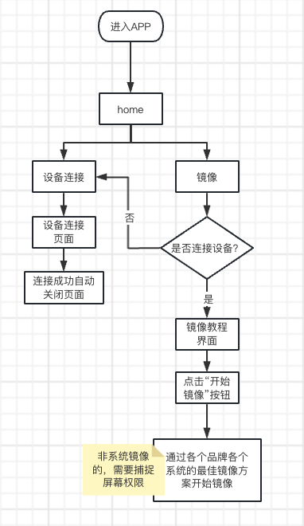
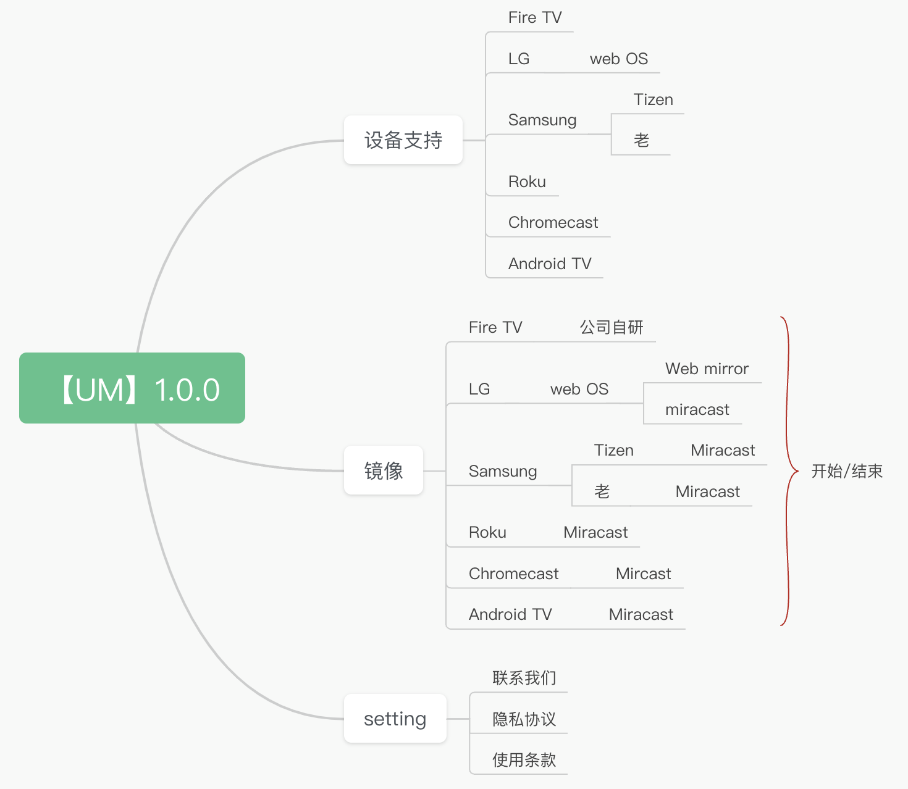
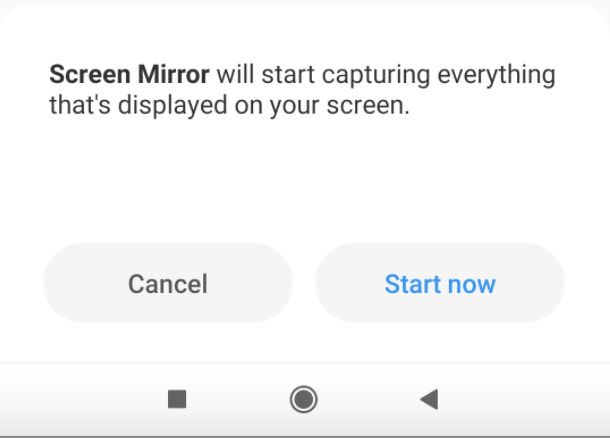
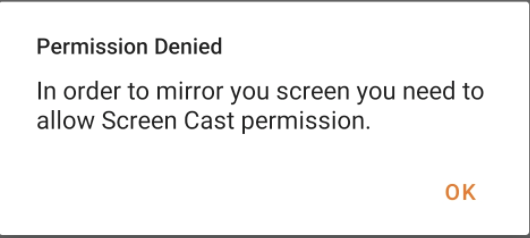
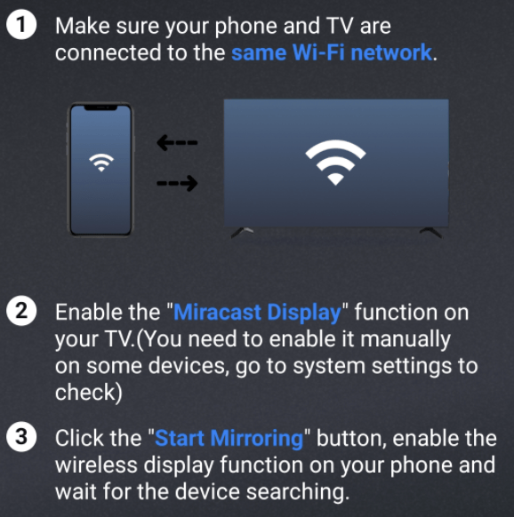
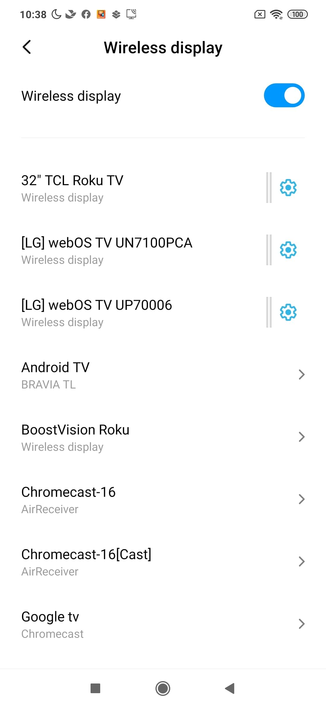

# 1 流程图&功能清单

## 1.1 流程图&功能清单 — 1

### 截图

### 说明

## 1.2 流程图&功能清单 — 2

### 截图

### 说明

# 2 权限

## 2.1 权限 — 1

### 截图

### 说明

批注1：【权限弹出时机说明】 「网络权限」 每次启动App时检测，无wifi或权限时，设备搜索页进入无wifi去设置状态 「捕捉屏幕权限」 1. 首次连接设备成功后，点击“开始镜像”按钮，如果采用非系统镜像方案，则弹出权限确认底部浮层 1.1 同意授权：开始启动镜像 1.2 取消授权/点击空白处关闭：弹窗提示，点击“OK”，关闭提示弹窗 2. 每次连接设备成功后，点击“开始镜像”按钮，都要读取权限，没有权限的话，继续进行捕捉屏幕权限获取询问

## 2.2 权限 — 2

### 截图

### 说明

# 3 设备搜索连接

## 3.1 设备搜索连接

### 说明

批注1：【设备搜索页面】 「页面」 1. 页面设计 2. 加载的动效 「逻辑」 1、支持搜索出多个设备，暂时未做设置数量限制，目前不限制搜索到的类型： 1.1 Samsung（新、老）、Roku、FireTV、LG（web OS）、Chromecast这部分设备，连接后会有对应的最佳镜像方案 1.2 其余设备，点击连接后，跳转系统镜像方案 2、已链接设备和未链接设备有状态区别： 2.1 已配对状态时点击设备即链接设备，链接成功后直接关闭设备搜索界面，进入对应最佳的镜像方案页面 2.2 未配对状态时，点击弹出弹窗提示用户需要操作匹配 * 需要匹配的设备：新LG（Pin码连接）、Fire TV（开启ADB） * Fire tv电视未匹配但用户已经关闭弹窗时，进入加载等待状态，（设备旁边没有转圈和✅），需要用户再次点击设备链接 3、该界面的设备链接状态与首页的设备状态展示区域一致 4、每次打开设备搜索界面，开启设备搜索状态。 4.1 10s后未搜索到设备，弹出无设备状态，但持续保持搜索状态 4.2 10s内搜索到设备并连接，则停止设备搜索状态。需要用户手动刷新设备或者再次打开设备连接界面，再次开始搜索设备。（一直刷新会导致设备连接状态混乱）

## 3.2 No wifi

### 说明

批注1：【NO Wi-Fi】 「页面」 页面设计 「逻辑」，author(点击“Go Settings”按钮，跳转到App系统Wi-Fi配置界面)

## 3.3 Searching

### 说明

批注1：【搜索中页面】 「逻辑」 可能会出现搜索中的符号情况： 1、空列表，搜索中，如图 2、搜索中陆续有搜索结果时，依次展示搜索出来的结果列表 3、有搜索结果列表时，进入搜索界面开始搜索状态，搜索结果列表与搜索中共存，并根据搜索的情况更新结果列表 设备搜索结果列表排序规则：设备类型&gt;设备名称 1、设备类型排序规则：新Samsung&gt;老Samsung&gt;Roku&gt;FireTV&gt;新LG、Android TV&gt;Chromecast，所有同类型设备排列在一起 2、设备名称排序规则：按照设备名称首字母排序，英文字母&gt;其他语言&gt;符号 2.1 字母类型内按照a-z排序；其他语言同类型语言排在一起，语言的类型的排序开发可自定义；同类符号排一起，具体的符号之间的排序开发自定义。

## 3.4 No Device

### 说明

批注1：【搜索不到设备】 「界面」 页面设计 「逻辑」 1. 打开搜索界面后，10s搜索不出来设备或在设备搜索结果页面10s无任何操作时，弹出提示，文案如图，继续保持搜索状态。 2. 出现有无设备提示后，关闭搜索界面，再打开搜索界面，则提示消失，重新开始搜索，10s搜索不出来设备或在设备搜索结果页面10s无任何操作时再出现 3. 出现有无设备提示框后，如果搜索到了任意新设备或用户有点击任意设备的操作，则提示消失 4. 点击“Contact Us”跳转Google表单

# 4 connect（新Samsung、新LG、Fire TV）

## 4.1 connect（新Samsung、新LG、Fire TV） — 1

### 截图

### 说明

批注1：【设备连接——Fire TV】 1. 链接FireTV设备时，设备返回未开启ADB状态，弹出提示弹窗，设备是未链接状态 1.1 Cancel：关闭弹窗，返回设备链接界面 Instructions：关闭弹窗，打开ADB教程 2. 设备如果已开启ADB，则点击链接，会检查用户电视上有无镜像的APK，如果用户电视上没有镜像APK，则会显示弹窗，用户不可做其他操作，但是可以点击“cancel”取消弹窗，停留在当前界面，取消弹窗后仍继Push APK覆盖老APK或安装新APK（电视上APK与当前所需版本不一致）；如果用户电视有已有需要的APK，则不显示弹窗。 3. 在APK安装好后，连接成功弹窗将自动关闭 4. 在网络不佳的情况下，五秒未连接成功，弹出“remind”弹窗，30s后或用户点击“OK”，则弹出“Warning”弹窗。需要用户再次点击设备链接

批注2：【设备连接——新LG】 「页面」 弹窗 「逻辑」 1. 点击新LG设备，出现pin码输入弹窗 1.1 pin码输入不完整/错误，点击OK后未匹配时，弹出错误提示（x的图标） 1.2 点击“Cancel”关闭弹窗，弹出错误提示（x的图标）

批注3：【设备连接——新Samsung】 「页面」 弹窗 「逻辑」 1. 点击新Samsung设备，出现弹窗 1.1 用户在电视端点击匹配，匹配成功后，手机自动关闭该弹窗，设备连接成功 1.2 用户提前关闭了弹窗，匹配成功，也设备连接成功 1.3 用户在电视端未点击匹配，匹配失败，需要用户手动关闭该弹窗出现确认弹窗，点击右上角关闭弹窗 2. 点击下方的链接，出现教程，教程文案：https://www.samsung.com/ph/support/tv-audio-video/how-to-control-a-samsung-tv-without-a-remote/

批注4：其他设备连接成功后，自动关闭设备连接页面

批注5：https://www.samsung.com/ph/#productsupport/

## 4.2 connect（新Samsung、新LG、Fire TV） — 2

### 截图

### 说明

## 4.3 connect（新Samsung、新LG、Fire TV） — 3

### 截图

### 说明

## 4.4 connect（新Samsung、新LG、Fire TV） — 4

### 截图

### 说明

## 4.5 connect（新Samsung、新LG、Fire TV） — 5

### 截图

### 说明

## 4.6 connect（新Samsung、新LG、Fire TV） — 6

### 截图

### 说明

## 4.7 connect（新Samsung、新LG、Fire TV） — 7

### 截图

### 说明

## 4.8 connect（新Samsung、新LG、Fire TV） — 8

### 截图

### 说明

# 5 LG web os 网页UI

## 5.1 LG web os 网页UI

### 说明

批注1：【电视屏幕上的LG Webos的web mirror UI】 「界面」 1. 整个页面 2. 四个功能的按钮设计，以及对应状态的按钮设计 「逻辑」 1. 有“全屏/退出全屏”、“音量调整”、“暂停/启动”、“退出”共计四个功能，假如鼠标在按钮上悬停，有title效果 2. “全屏/退出全屏”——Full Screen/Exit full screen 2.1 点击全屏，进入全屏模式，“全屏”按钮变为“退出全屏”按钮 3.“音量”——Volume；“静音”——Mute 3.1 非静音状态下，鼠标悬停在“音量”按钮上时，出现音量调整条，点击进行调整；直接点击“音量”按钮主体，变为静音状态 3.2 静音状态下，鼠标悬停在“静音”按钮上时，不出现音量调整条，点击“静音”按钮主体，变成音量调节状态 4. “暂停/启动”——Pause/Start 4.1 点击“暂停”按钮后，变成“启动”按钮，手机上有操作，但电视上画面停留在暂停时的画面；重新启动后，电视画面更新为手机上当前的画面 5. “退出”——Exit 5.1 能退出镜像的按钮：物理遥控器上的“电源”；电视浏览器右上角的“关闭”；手机APP内的“stop mirroring”；电视屏幕上的“退出”。 5.2 退出是指电视屏幕上停止镜像，画面停留在手机上停止镜像的最后一帧；手机APP内按钮显示“start mirroring”，手机APP内和电视屏幕上的镜像状态保持一致 5.3 全屏状态下不出现退出按钮

# 6 主页

## 6.1 主页 — 1

### 截图

### 说明

批注1：【主页】 「界面」 1. 启动页面设计 2. 主页界面设计 「逻辑」 1. 启动APP后，进入主页 2. 主页上有“镜像”、“链接设备”、“设置”、“troubleshoot”功能，点击进入对应的页面 3. 点击“troubleshoot”，跳转原生trouble shoot界面 文案：https://boostvision.feishu.cn/docx/MylyduNzjoxjOXxpaNfcDGfDnjh?from=from_copylink

批注2：【更新提示重启条】 「界面」 「逻辑」 1. 有新版本后，用户打开APP，会有Google的下载APP提示弹窗，下载完成后，APP内会出现该“更新提示重启条” 2. 在APP下载过程中，用户可以继续操作 3. 点击系统返回，或点击空白处，可以收起“更新提示重启条”，则等有新版本后，重复上述操作 4. 点击“restart”，立刻重启APP，完成更新

批注3：【退出APP】 「逻辑」 在主页点击返回，toast提示“Tap again to exit“，展示3s，在toast展示的3s内再次点击系统返回，则退出APP；如果在3s后，（toast消失）再次点击系统返回，则重新出现toast提示

批注4：【镜像页面】 「逻辑」 1. 设备已连接的情况下，根据连接设备的选择最佳镜像方案，进入对应教程 2. 在设备未连接的状态下，则先进入设备连接页面 2.1 连接失败：用户点击返回，则返回主页 2.2 连接成功：自动跳转连接设备的对应最佳镜像方案的教程

批注5：【Miracast教程】 「页面」 整个页面（内容与Universal remote的镜像页面相同） 「逻辑」 1. 在连接Samsung（新、老）、Roku、Chromecast设备后，进入screen mirror页面，出现miracast教程 2. 点击“Go Mirroring”跳转系统镜像界面，按钮文案不变 3. 在镜像过程中点击“Start Mirroring”，依然跳转到系统镜像

批注6：【针对小部分设备不支持miracast的toast】 1. 在用户点击“Go Mirroring”，检查用户的系统是否支持“Miracast”， *用户支持：按之前逻辑跳转Miracast *用户不支持：toast提示 2. toast文案（多语言）：显示3s 对不起，您的设备暂时不支持镜像 Sorry, your device currently does not support mirroring.

批注7：【Fire TV 自研镜像教程】 「页面」 正常页面&amp;选项置灰页面 「逻辑」 1. 在连接Fire TV设备后，进入screen mirror页面，出现相关选项 2. 只有在开始镜像前可以选择“quality”、“sound”选项，开始镜像后，选项置灰，不能选择；结束镜像后，可以重新设置 2.1 默认quality为high，sound开关为开 2.2 如果用户对设置进行修改，则记住上一次的设置 3. 在镜像过程中，用物理遥控板退出镜像和在APP内点击“Stop Mirroring”，APP内按钮变为“Start Mirroring”，电视均会退出镜像界面

批注8：【新LG—web mirror镜像中】 「页面」 文案：你可以在开始镜像后，使用触控板来选择使用相关的功能 「逻辑」 1. 点击“Start mirroring”，首先采用web mirror方案，如果5s内镜像加载不成功，则立即出现弹窗，切换到miracast方案，跳转系统镜像页面 2. 开始镜像后，“ Start Mirroring”文案变化为“Stop Mirroring” 3. 在镜像过程中，用物理遥控板退出镜像和在APP内点击“Stop Mirroring”时，APP内按钮变为“Start Mirroring”，电视上均会退出镜像界面

批注9：【web mirror教程】 「页面」 「逻辑」 1. 在连接新LG设备后，出现web mirror教程 2. 点击“Go Mirroring”，首先采用web mirror方案界面

批注10：【新LG—miracast镜像中】 「逻辑」 1. 开始镜像后，“Start Mirroring”文案不变 2. 镜像过程中点击“Start Mirroring”，跳转系统镜像页面 3. 停止镜像后，用户点击左上角返回按钮返回主页，重新点击“Screen mirror”——&gt;“Start Mirroring”，依然先尝试web mirror方案

批注11：【新LG—镜像方案切换】 「页面」 文案： 网络有一些问题，我们将为您提供另一种镜像方案 3s后自动跳转…… 「逻辑」 1. 如果使用web mirror方案镜像新LG设备失败，则出现提示弹窗，倒计时结束后，自动跳转系统镜像页面 2. 倒计时过程中，可以通过弹窗上的关闭按钮，和系统返回按钮关闭弹窗，回到上级页面，点击“Start Mirroring”再次先采用web mirror方案，如果5s内不成功，则出现弹窗

批注12：【Setting页面】 「页面」 页面设计 「逻辑」 1. 共计4个功能，“疑难解答”、“联系我们”、“使用条款”、“隐私协议”，排序如图 2. 点击“联系我们”，跳转Google表单 3. 点击“使用条款”、“隐私协议”跳转对应的浏览器协议界面 4. 点击“疑难解答”，跳转原生trouble shoot界面 trouble shoot文案：https://boostvision.feishu.cn/docx/MylyduNzjoxjOXxpaNfcDGfDnjh?from=from_copylink

## 6.2 主页 — 2

### 截图

### 说明
