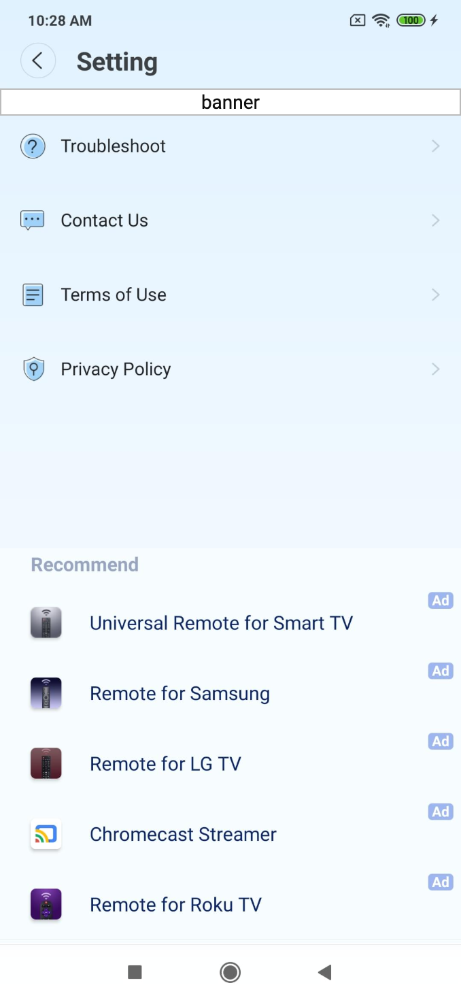
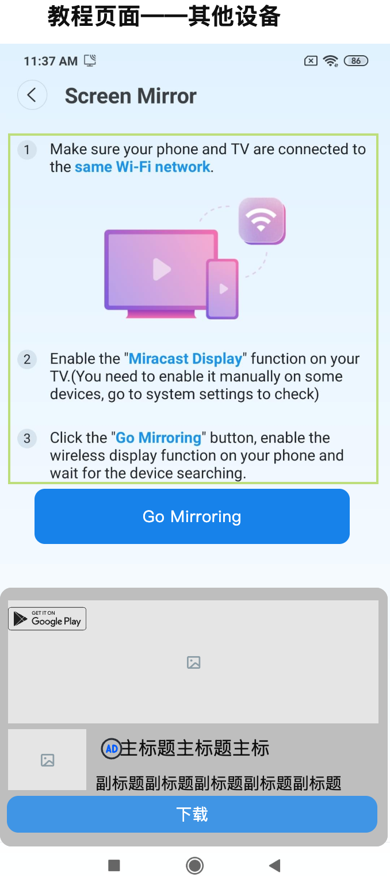
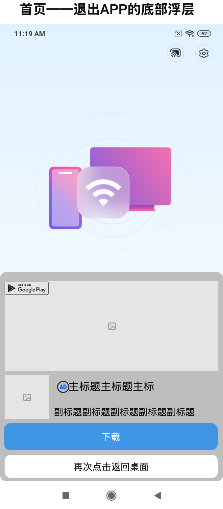
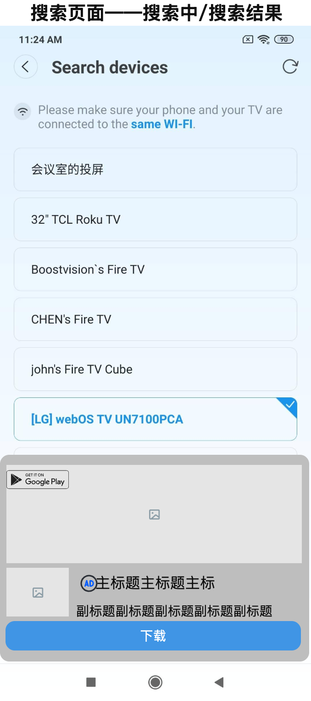
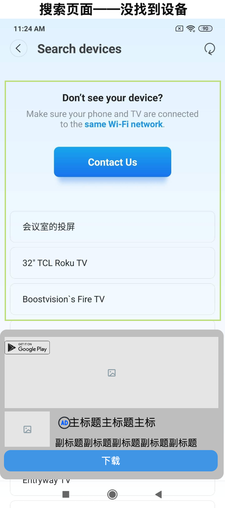
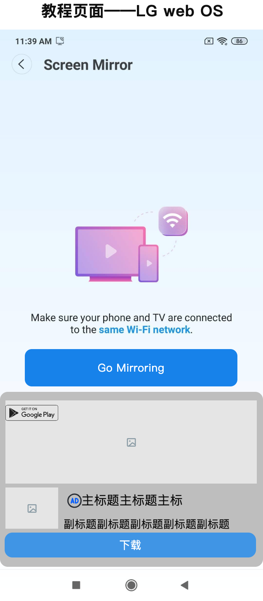
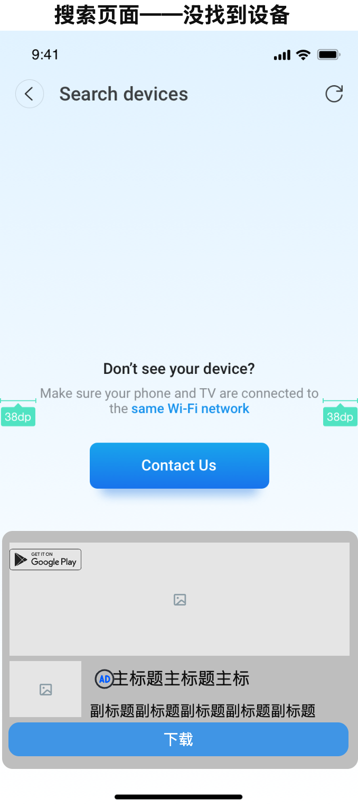
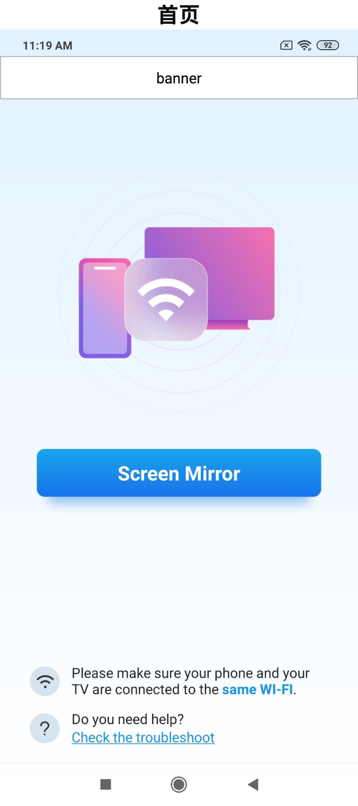
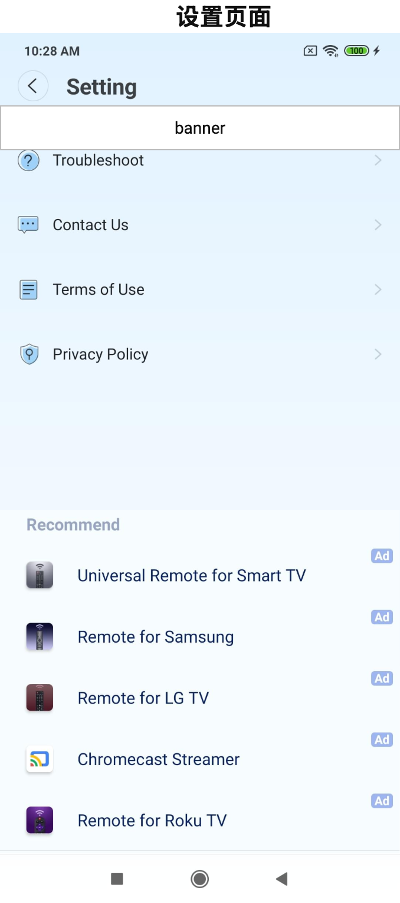

# 1 搜索设备重名问题

## 1.1 搜索设备重名问题

### 说明

批注1：【搜索设备重名逻辑】 1. 搭载chromecast的设备，按当前的逻辑去重 2. 其他设备不做去重

# 2 GDPR

## 2.1 GDPR

### 说明

批注1：【GDPR】 1. GDPR流程整体改为异步，应用启动的时候从后台获取数据。GDPR获取数据回来的时候，如果还在开屏阶段，未进入主页，则等待进入主页的时候再弹出（避免和开屏动画及开屏广告冲突）。 2. 如果已经结束了开屏阶段，则GDPR立即弹出。此时正在展示插屏广告的话，则弹出的界面在插屏广告之下，用户手动关闭插屏广告之后即可操作 3. 对于不支持GDPR的国家，因为已经改成异步，因此从GDPR后台数据可以判定不支持，不会弹出对话框，也不会增加等待时间，因此用户无感。不用特殊处理

# 3 开屏动画+开屏广告

## 3.1 开屏动画+开屏广告

### 说明

批注1：【开屏】ca-app-pub-3925850724927301/2211106696 「界面」 1. 开屏动画（5s） 「逻辑」 1. 启动APP时，播放开屏动画（5s），并同时加载开屏广告 1.1 如果在5s内加载成功，则展示开屏广告 1.2 如果5s内没有加载成功，则继续加载至加载成功，在下一次进入APP时展示 2. 启动APP时，检测网络情况，在完全没网络的情况下，不播放开屏动画，直接进入首页

# 4 设置页面引流广告

## 4.1 设置页面引流广告

### 页面布局

### 说明

批注1：【设置页面—引流】 「界面」 1. 引流位排版设计 2. AD标识设计 「逻辑」 1. 8个引流APP的资源都需要新增（后续有新增的APP都需要新增，不仅限于8个），但APP内最多展示5个，展示的APP以及排序根据firebase的配置来展示。 2. 如果配置了超过5个的APP，则仅展示前5个 3. 引流资源：Fire Tv、TvCast、Samsung Remote、LG Remote、Roku Remote、Screen Mirror、IPTV、Universal remote

批注2：【系统按钮】 「界面」，author(需要一个背景色，和界面区分)

# 5 native广告

## 5.1 native广告 — 1

### 页面布局

### 说明

## 5.2 native广告 — 2

### 页面布局

### 说明

批注1：【退出APP浮层广告】 「界面」 native广告+退出APP按钮（TAP AGAIN TO EXIT） 「逻辑」 1. 在首页单击系统返回，弹出底部确认退出浮层（上方附带native广告，加载逻辑和之前相同） 3. 点击“再次点击返回桌面”或“系统返回”返回手机桌面、点击浮层外的空白处，回到首页 4. 完全没有网络的情况下，点击“系统返回”，不展示该底部浮层，直接toast提示“TAP AGAIN TO EXIT”，toast展示3s，用户在toast展示状态中，再次点击系统返回，则退出APP；用户在toast展示完后，再次点击“系统返回”，则再次展示toast。

## 5.3 native广告 — 3

### 页面布局

### 说明

## 5.4 native广告 — 4

### 页面布局

### 说明

批注1：【搜索页面——找不到设备UI变动】 「逻辑」 1. 目前：只有设备可以滑动 修改后：“找不到设备”模块可以和设备一起滑动

## 5.5 native广告 — 5

### 页面布局

### 说明

批注1：【native广告逻辑汇总】 搜索设备页面、教程页面：ca-app-pub-3925850724927301/4645698342 退出APP的底部浮层native：ca-app-pub-3925850724927301/7415164047 「界面」 1. 加载中的加载框（横屏）+广告标识 2. 横版+竖版UI 3. native广告位置：搜索设备页面底部、教程页面底部、退出APP时的底部浮层 「逻辑」 1. 加载规则：用户trigger了有native广告位的页面，才开始加载native广告，加载成功后，则展示native广告 1.1 消耗一个native广告后，用户再次trigger一个有native广告位置的页面后，才开始加载新的native广告 1.2 如果用户在有native广告的页面停留，超过30s后，开始加载下一个广告，在下一个广告加载成功之前，仍然展示原广告 1.3 如果在下一个native广告还没有预加载成功时，用户就已经trigger到下一个有native广告的页面了，该页面需要展示加载框，并继续加载广告 1.4 加载前先检查是否有上次加载成功但未展示的广告，有的话先展示上次的广告，不同位置的缓存也可用 2. 加载失败策略： 加载失败后，间隔3s再次尝试加载 2.1 请求连续加载失败4次，计为1个失败，间隔30s之后继续主动加载 2.2 若加载1个广告失败后，间隔计时还未到30s，用户就trigger了下一个有native广告的页面，则立马加载下一个native广告（就是说30s、3s计时会被用户的trigger打断，trigger的层级高于30s、3s的间隔计时）(trigger后4次request不用重新计数) 2.3 连续4个native广告都加载失败，本次启动app都不再加载（native的加载框也不再展示） 2.4 针对退出APP的底部浮层广告 *退出APP的底部浮层广告最多只有4次加载失败的机会 * 如果用户触发了退出APP的底部浮层广告，一直停留，如果失败了四次，则停留在加载状态 3. 无网络状态，不加载广告 4. 这三个位置的native广告都偏好加载横屏广告 5. 【新增】如果在某一个位置native已经展示了15s（&lt;30s）时，将软件退到后台，则计时器会停止，并且回到软件回到前台，也无法继续计时（开发难度大）

批注2：【教程页面】 「逻辑」 1. native广告和“Go Mirroring按钮”固定，教程内容可以滑动

## 5.6 native广告 — 6

### 页面布局

### 说明

# 6 banner页面

## 6.1 banner页面 — 1

### 页面布局

### 说明

## 6.2 banner页面 — 2

### 页面布局

### 说明

批注1：【Banner广告】ca-app-pub-3925850724927301/4820177914 「页面」 1. 加载框 2. 加载动效 「逻辑」 1. 进入banner所在页面后，才开始加载banner广告 2. 谷歌自动优化刷新（产品后台配置） 3. 无网络状态，不加载广告，也不展示加载框

