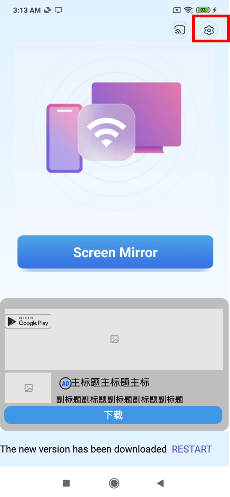

# 1 小额付费

## 1.1 小额付费

### 说明

# 2 页面 5

## 2.1 页面 5

### 说明

# 3 首页广告修改

## 3.1 首页广告修改

### 页面布局

### 说明

批注1：【点击设置，出现插屏】 「逻辑」 1. 广告ID：ca-app-pub-3925850724927301/2448671571 2. 加载逻辑：启动APP后，预加载一个插屏广告，消耗一个后不再进行预加载（即消耗一个后，下一次点击setting后开始request，再下一次点击后进行展示） 3. 有检查插屏缓存机制，和其他位置的缓存不共用 4. 加载失败逻辑不变

批注2：【native加载&amp;加载失败逻辑】 1. 加载规则：用户trigger了有native广告位的页面，才开始加载native广告，加载成功后，则展示native广告 1.1 消耗一个native广告后，用户再次trigger一个有native广告位置的页面后，才开始加载新的native广告 1.2 如果用户在有native广告的页面停留，超过30s后，开始加载下一个广告，在下一个广告加载成功之前，仍然展示原广告 1.3 如果在下一个native广告还没有预加载成功时，用户就已经trigger到下一个有native广告的页面了，该页面需要展示加载框，并继续加载广告 1.4 加载前先检查是否有上次加载成功但未展示的广告，有的话先展示上次的广告，不同位置的缓存也可用 2. 加载失败策略： 加载失败后，间隔3s再次尝试加载 2.1 请求连续加载失败4次，计为1个失败，间隔30s之后继续主动加载 2.2 若加载1个广告失败后，间隔计时还未到30s，用户就trigger了下一个有native广告的页面，则立马加载下一个native广告（就是说30s、3s计时会被用户的trigger打断，trigger的层级高于30s、3s的间隔计时）(trigger后4次request不用重新计数) 2.3 连续4个native广告都加载失败，本次启动app都不再加载（native的加载框也不再展示） 3. 无网络状态，不加载广告 4. 这三个位置的native广告都偏好加载横屏广告 5. 如果在某一个位置native已经展示了15s（&lt;30s）时，将软件退到后台，则计时器会停止，并且回到软件回到前台，也无法继续计时（开发难度大）

批注3：【banner/native可切换】 「界面」 native广告 「逻辑」 1. native广告ID：ca-app-pub-3925850724927301/4645698342 2. native加载逻辑不变 3. 首页的广告可以通过配置切换（banner/native），当banner配置开关和native配置开关都打开时，则展示native 4. 滑动区域：绿色方框

# 4 LG WebOS触控板变按钮+Fire TV加native

## 4.1 LG WebOS触控板变按钮+Fire TV加native — 1

### 页面布局

### 说明

批注1：【LG点击开始镜像后的加载状态】 「界面」 加载状态 「逻辑」 1. 点击“Start mirroring”，首先采用web mirror方案，如果15s（之前是5s）内镜像加载不成功，则立即出现弹窗，切换到miracast方案，跳转系统镜像页面 2. 点击“Start mirroring”，出现加载状态，点击stop mirror可以停止镜像

## 4.2 LG WebOS触控板变按钮+Fire TV加native — 2

### 页面布局

### 说明

批注1：【LG web OS——web mirror】 「界面」 1. 电视UI上去除功能按钮 2. 三个功能的按钮设计，以及对应状态的按钮设计（音量调节、全屏/退出全屏、播放/暂停） 3. native广告，页面调整 「逻辑」 1. 功能逻辑不变，音量，静音与否、播放/暂停与电视端保持同步 2. 新增native广告，使用旧广告ID：ca-app-pub-3925850724927301/7415164047，native广告加载&amp;加载失败逻辑也不变 3. 滑动区域：绿色方框 4. 打开web mirror后的默认是静音（政策要求），预设音量为10 5. 【新增】目前可以实现电视端和手机端的同步，电视关闭后，手机端的镜像也停止 6. 【新增】音量控制范围是0-100 7. 【新增】在web mirror开始前，点击功能按钮，toast 提示“Please start mirroring first”（2s）

## 4.3 LG WebOS触控板变按钮+Fire TV加native — 3

### 页面布局

### 说明

批注1：【Fire TV】 「界面」 1. native广告、页面调整 「逻辑」 1. 新增native广告，使用旧广告ID：ca-app-pub-3925850724927301/7415164047，native广告加载&amp;加载失败逻辑也不变 2. 滑动区域：绿色方框

批注2：【native加载&amp;加载失败逻辑】 1. 加载规则：用户trigger了有native广告位的页面，才开始加载native广告，加载成功后，则展示native广告 1.1 消耗一个native广告后，用户再次trigger一个有native广告位置的页面后，才开始加载新的native广告 1.2 如果用户在有native广告的页面停留，超过30s后，开始加载下一个广告，在下一个广告加载成功之前，仍然展示原广告 1.3 如果在下一个native广告还没有预加载成功时，用户就已经trigger到下一个有native广告的页面了，该页面需要展示加载框，并继续加载广告 1.4 加载前先检查是否有上次加载成功但未展示的广告，有的话先展示上次的广告，不同位置的缓存也可用 2. 加载失败策略： 加载失败后，间隔3s再次尝试加载 2.1 请求连续加载失败4次，计为1个失败，间隔30s之后继续主动加载 2.2 若加载1个广告失败后，间隔计时还未到30s，用户就trigger了下一个有native广告的页面，则立马加载下一个native广告（就是说30s、3s计时会被用户的trigger打断，trigger的层级高于30s、3s的间隔计时）(trigger后4次request不用重新计数) 2.3 连续4个native广告都加载失败，本次启动app都不再加载（native的加载框也不再展示） 3. 无网络状态，不加载广告 4. 这三个位置的native广告都偏好加载横屏广告 5. 如果在某一个位置native已经展示了15s（&lt;30s）时，将软件退到后台，则计时器会停止，并且回到软件回到前台，也无法继续计时（开发难度大）

# 5 针对stop mirror的插屏广告的补充

## 5.1 针对stop mirror的插屏广告的补充

### 截图

### 说明

批注1：【补充】 加载逻辑中的“开始镜像”是指电视端真实的镜像，而不是指点击“star mirroring”

