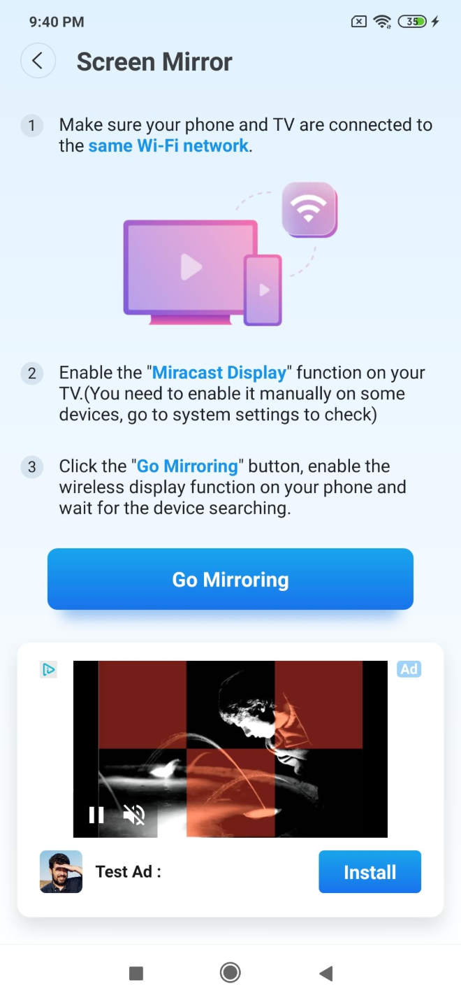

# 1 GP系统评分

## 1.1 GP系统评分

### 页面布局

### 说明

批注1：【GP评分】 「逻辑」 1. 一次新安装或一个新版本内，用户首次连接设备成功的前3天，连接页面自动关闭后，弹出GP评分，一次安装或一个新版本内只能弹出三次 （单天内最多触发一次，即用户单天内成功连接设备5次，但只有第一次会触发GP评分请求） 2. 优先级：GDPR&gt;评分&gt;广告，如果评分界面和广告冲突，则只展示评分，GDPR不限制，但GDPR不会和其他弹窗同时出现 2.1 触发GP评分时，连接设备成功后的插屏和教程页面的native都不展示 2.2 如果判定本次会触发GP系统评分，则不同时去请求native（即不会同时去请求GP评分和教程页面的native） *如果用户关闭了系统评分，则可以继续请求该位置的naive 3. 通过配置控制GP评分开关

# 2 自定义评分

## 2.1 自定义评分 — 1

### 页面布局

### 说明

批注1：【设置页面调整】 「界面」 1. 新增Rate us选项，排序如图所示，并做功能分类 「逻辑」 1. 通过配置控制自定义评分的开关 true：点击rate us，出现自定义评分 False：点击rate us，直接跳转谷歌评分页面

## 2.2 自定义评分 — 2

### 页面布局

### 说明

## 2.3 自定义评分 — 3

### 页面布局

### 说明

批注1：【自定义评分】 「界面」 1. 图标元素：表示赞同、星星 2. 文案多语言：Mind leaving us a 5-stars review? 3. 星级状态 *1～3星：哭脸+比较暗淡的颜色 *4&amp;5星：笑脸+比较明亮的颜色 4. 按钮 「逻辑」 1. 点击rate us选项，出现自定义评分 2. 跳转逻辑 1～3星+confirm：关闭弹窗跳转contact us表单 4&amp;5星+sure！：关闭弹窗并跳转谷歌评分页面 Maybe Later：关闭弹窗 3. 在自定义弹窗出现时，屏蔽系统的返回按钮

批注2：【动画交互】 1. 背景动画和星星动画是两个独立的动画 2. 当用户在星星的动画进行中选择星级时，则立刻停止星星动画，并直接展示背景动画的最后呈现画面

# 3 新增获取用户设备信息埋点

## 3.1 新增获取用户设备信息埋点

### 说明

批注1：【新增获取用户设备信息埋点】 1. 用户打开APP就开始回传，搜索到一个设备就传一个，在一次installs内，需要去重，只回传一次 2. 设备信息：类型～manufacturer～modelName～modelNumber～friendlyName～sec:ProductCap～最后有空位的话，返回详细类型信息 （拿不到的部分X代替） 类型：1: DIAL；2: DLNA；3: ROKU；4: WEBOS；5: Samsung legacy manufacturer：厂商 modelName&amp;modelNumber friendlyName：用户自定义设备名称，老设备可能不支持自定义修改设备名称，所以拿到的是设备型号 sec:ProductCap：大概率只有samsung设备有

# 4 多语言

## 4.1 多语言

### 说明
