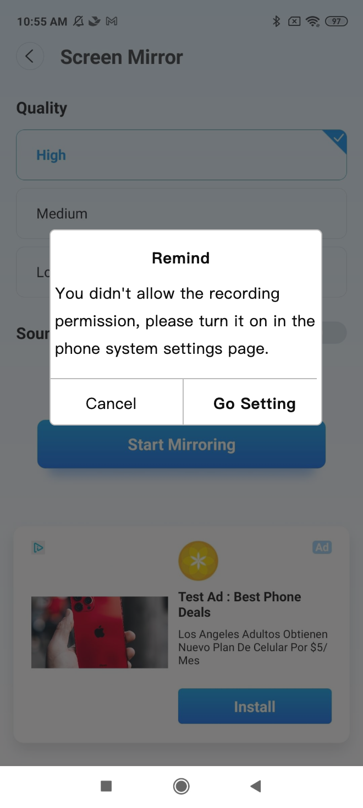

# 1 GoogleCast协议镜像

## 1.1 GoogleCast协议镜像 — 1

### 页面布局

### 说明

## 1.2 GoogleCast协议镜像 — 2

### 页面布局

### 说明

批注1：【中文】 点击“开始镜像”按钮进行屏幕镜像 【英文】 Click the "Start Mirrroring" button to mirror screen. 【中文】 请等待 【英文】，author(Please Wait)

## 1.3 镜像超时

### 页面布局

### 说明

# 2 优化native布局

## 2.1 优化native布局

### 页面布局

### 说明

批注1：【修改native AD标识宽高】 「界面」 1、根据政策，Ad宽高&gt;=15px，图片宽高&gt;=120px； 「逻辑」 1、所有native的ad标识都需要修改； 2、尽量通过原始dp值去做大小，或者通过代码动态计算Dp2Px；

# 3 相关改动

## 3.1 相关改动

### 说明

批注1：【增加Google Mirror Sender改动】 1、设备搜索需要从Google SDK修改为NSD搜索 2、之前Firetv、WebMirror各自持有了一套录屏库，现在准备移除掉各自的录屏库采用安卓这边整理的一套独立的录屏库，于是要先修改之前的发送的库 测试注意：把所有Mirror的情况都跑一边

# 4 录音权限提醒

## 4.1 录音权限提醒

### 页面布局

### 说明

批注1：【录音权限提醒】 「界面」 1. 弹窗 2. 文案 【英文】Remind 【中文】提示 【英文】You didn't allow the recording permission, please turn it on in the phone system settings page 【中文】您之前已经拒绝了录音权限，请在手机系统设置页面中打开它 【英文】Cancel 【中文】取消 【英文】Go Setting 【中文】去设置 「逻辑」 1. 用户拒绝过一次录音权限后，再次打开“sound”开关，则出现权限提示弹窗 2. 点击cancel关闭弹窗，点击Go setting，关闭弹窗，跳转系统权限设置页面 2.1 仅能通过cancel关闭弹窗

