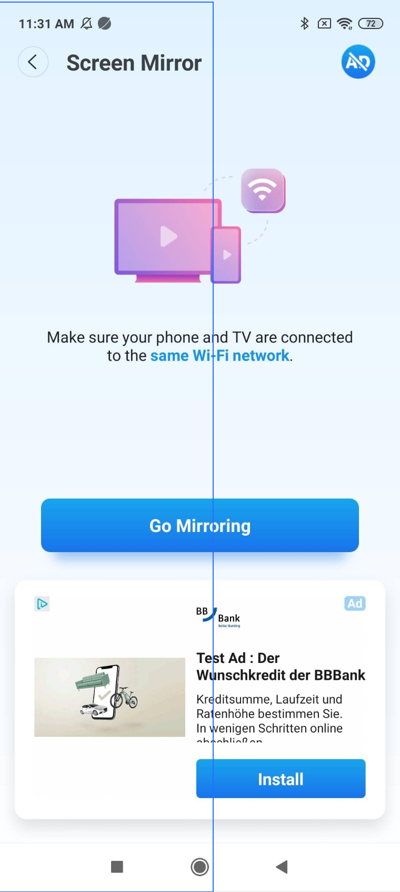
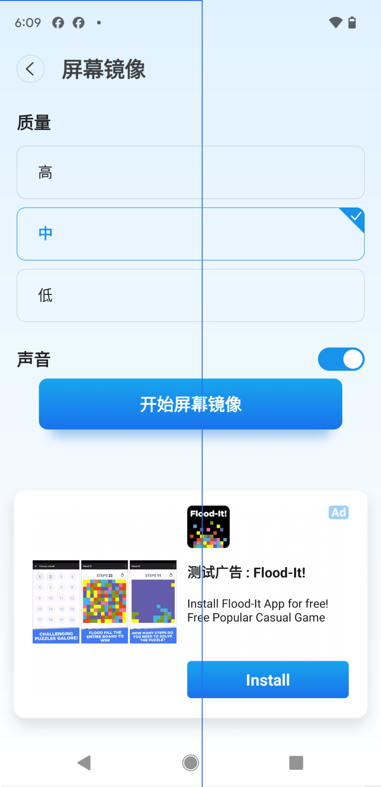
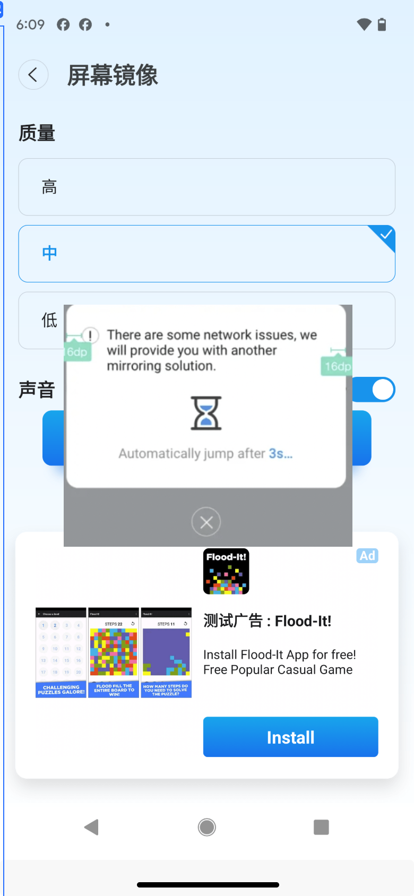

# 1 GoogleCast协议镜像

## 1.1 GoogleCast协议镜像 — 1

### 页面布局

### 说明

批注1：GoogleCast协议镜像说明：  【界面】  1、ChromeCast、Android TV设备进入Mirror，展示【教程界面】，与LG相同；  2、点击【教程界面】的Go Mirroring，再进入【参数选择界面】，与FireTV、LG相同；  【逻辑】  1、Chromecast、Android TV相关的设备采用自研的GoogleCast协议进行连接；  2、连接成功后，进入ScreenMirror，展示【教程界面】——【参数选择界面】；（页面变化如左图所示）  3、选择参数逻辑同FireTV、LG；  4、点击“Start Mirroring”，直接开始镜像（采用自研的GoogleCast协议）；  * 点击“Start Mirroring”后，按钮变为“Stop Mirroring”，展示等待动画；  * 不影响用户点击“Stop Mirroring”，可直接结束准备镜像的进程；  * 弹出【开始镜像窗口】后，展示动画消失；  * 若关闭【开始镜像窗口】，按钮直接变为“Start Mirroring”，需重新开始镜像；  * 开始镜像后，不可更改参数，点击“Stop Mirroring”，结束镜像；  * 镜像中，切换设备立即结束镜像，恢复未镜像状态；  5、麦克风权限：首次连接设备成功后，点击“Start Mirroring”按钮，弹出权限弹窗；  * 用户选择打开Audio时，判断是否授权，若为授权，弹出权限弹窗；  6、捕捉屏幕权限：每次连接设备成功后，点击“Start Mirroring”按钮，都要读取权限，没有权限的话，继续进行捕捉屏幕权限获取询问；  7、参数选择页仍含原生广告，点击“Stop Mirroring”仍有插屏广告，逻辑不变，受配置控制；  文案：  【Google自研镜像中，通知栏文案】  The device is Mirroring

## 1.2 GoogleCast协议镜像 — 2

### 页面布局

### 说明

## 1.3 镜像超时

### 页面布局

### 说明

批注1：镜像超时说明：  【逻辑】  1、连接Chromecast、LGWebOS设备，点击“Start Mirroring”，先判断是否支持自研镜像；  （1）若不支持，则继续判断手机是否支持系统镜像；  * 若支持系统镜像，则立即弹出【切换镜像提示弹窗】，弹窗部分的逻辑不变，同LG_Webos；  * 若不支持系统镜像，则立即弹出不支持镜像的Toast提示，该提示的展示逻辑同以往一致；  （2）若支持自研镜像，LG维持原超时逻辑，Chromecast用户若5s后仍未与设备建立连接，则立即弹出【切换镜像提示弹窗】；

# 2 优化native布局

## 2.1 优化native布局

### 页面布局

### 说明

批注1：【修改native AD标识宽高】 「界面」 1、根据政策，Ad宽高&gt;=15px，图片宽高&gt;=120px； 「逻辑」 1、所有native的ad标识都需要修改； 2、尽量通过原始dp值去做大小，或者通过代码动态计算Dp2Px；

# 3 相关改动

## 3.1 相关改动

### 截图

### 说明

批注1：【增加Google Mirror Sender改动】 1. a. 2. 之前Firetv、WebMirror各自持有了一套录屏库，现在准备移除掉各自的录屏库采用安卓这边整理的一套独立的录屏库，于是要先修改之前的发送的库 测试注意：把所有Mirror的情况都跑一边

# 4 插屏广告合规

## 4.1 页面 1

### 截图

### 说明

批注1：【设备连接成功后插屏广告】 「逻辑」 1. 设备连接成功后，先判断是否含有GP评分； a. 若存在GP评分，则不弹出插屏广告，toast和Mirror按照原逻辑展示； b. 若不存在GP评分，需先弹出插屏广告，再进入Mirror页，展示连接成功toast； 2. 设备连接成功弹出插屏广告请求时机更改： a. 首次请求：仍在启动APP后，预加载一个插屏广告； b. 下次请求：上一个插屏广告消耗后，于进入设备连接页时，再去加载下一个，若加载失败，仍遵循之前的加载失败逻辑；

